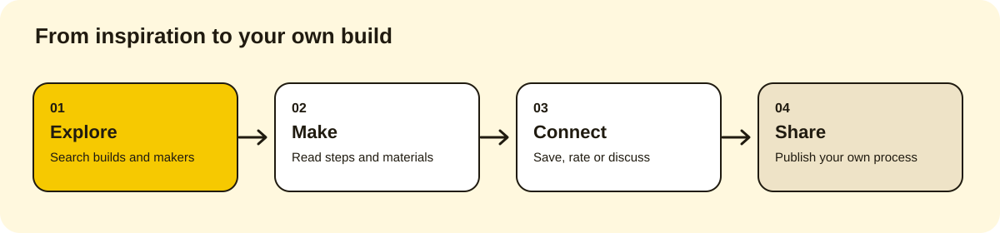
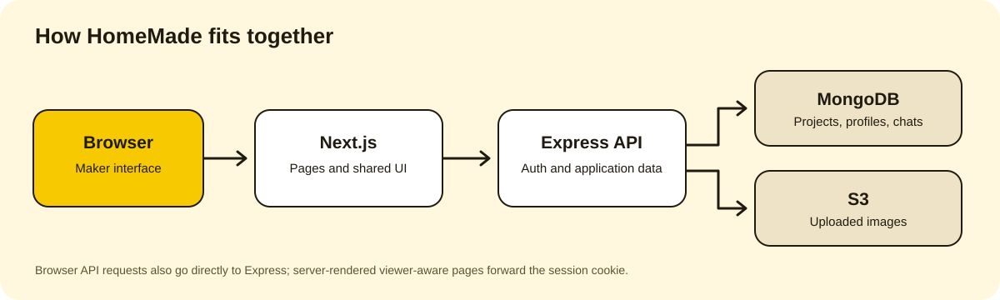

# HomeMade


HomeMade is a community for finding DIY builds and sharing the steps, materials, tools, and photos behind a project. Makers can explore projects and profiles, save and rate builds, leave comments, and exchange messages.



## Getting started

You need Node.js 20 or newer, npm, and a disposable MongoDB database. Image uploads additionally need a test S3 bucket and AWS credentials. Run the commands below from the repository root; the frontend is an npm workspace.

1. Copy `.env.example` to `.env`, set `DATABASE_URL` and `SESSION_SECRET`, and configure whichever optional services you need. Do not commit `.env` or real credentials.
2. Start your disposable MongoDB instance.
3. Install the locked dependencies and start both applications:

   ```bash
   npm ci
   npm run dev
   ```

4. Open **http://localhost:3001**. Next.js serves the UI on port 3001; Express serves the API, authentication, and public assets on port 3000.

Run one side with `npm run dev:server` or `npm run dev:client`. To check a change, run `npm test` for the offline regressions and `npm run build:client` for the production frontend build. Offline tests do not replace checks against MongoDB, S3, OAuth providers, or a browser. See [PLAN.md](PLAN.md) for the current verification status and remaining work.

## How it works



- `frontend/app/`, `frontend/components/`, and `frontend/lib/` contain the Next.js App Router UI.
- `routes/api.js`, `controllers/api.js`, and `lib/serializers.js` implement the JSON API and response shapes. Express checks permissions and validates writes.
- `routes/auth.js`, `config/passport.js`, and `server.js` handle sign-in and sessions. The browser sends its session cookie to the API; viewer-aware server rendering also forwards it to Express.
- `models/` stores MongoDB schemas; `services/s3Service.js` handles image uploads. Existing Express page URLs redirect to the Next.js app, and chat uses the JSON API.

## Configuration

The sample in [.env.example](.env.example) contains the local defaults. Set `PORT` to change the Express port; Next.js uses port 3001 in the supplied development script.

| Setting | Purpose |
| --- | --- |
| `DATABASE_URL`, `SESSION_SECRET` | MongoDB connection and Express session signing. Use a disposable database and a strong secret. |
| `FRONTEND_URL`, `CLIENT_ORIGIN`, `API_BASE_URL` | Frontend and backend origins used by redirects, auth, and allowed-origin checks. |
| `NEXT_PUBLIC_API_BASE_URL` | Browser-visible API origin, defaulting to `http://localhost:3000`. Set it in the frontend environment before starting or building Next.js. |
| `GOOGLE_CLIENT_ID`, `GOOGLE_SECRET`, `GOOGLE_CALLBACK` | Enable Google sign-in when all three are configured. |
| `GITHUB_CLIENT_ID`, `GITHUB_CLIENT_SECRET`, `GITHUB_CALLBACK` | Enable GitHub sign-in when all three are configured. |
| `MICROSOFT_CLIENT_ID`, `MICROSOFT_CLIENT_SECRET`, `MICROSOFT_CALLBACK` | Enable Microsoft sign-in when all three are configured. |
| `AUTH_DEBUG_LINKS` | When `true` outside production, return local verification and magic links. Use only with a loopback-only test service and disposable accounts. |
| `S3_BUCKET`, `AWS_REGION` | Upload destination. Credentials come from the AWS SDK credential chain; `AWS_BUCKET_NAME` is a legacy bucket-name fallback. |
| `TRUST_PROXY_HOPS` | Number of trusted reverse-proxy hops, set only for a known deployment topology. |

Provider callbacks must match the URLs registered with their providers. Apple sign-in is disabled pending verification. Existing password accounts can sign in, but production email delivery, password recovery, and explicit provider linking are not implemented. Email signup, verification resend, and magic-link requests are unavailable unless development links are enabled.

Email-authentication POSTs share a limit of 30 requests per IP per 15 minutes **per server process**, with `Retry-After` on a 429 response. The limit resets on restart and is not shared across instances. Production needs a shared limiter or equivalent edge protection and an accurately configured proxy chain. Sessions currently use the in-memory store and need a durable store for production.

Uploads accept JPEG or PNG files up to 5 MB each, 10,000 pixels per side, and 40 megapixels. Project requests allow up to 12 new files. The server checks signatures and dimensions from image headers, not full decoding. Failed upload batches attempt to delete all attempted objects before a database write; S3 credentials therefore need `s3:PutObject` and `s3:DeleteObject` for app-owned keys. Cleanup is best effort and ambiguous database-write outcomes still need reconciliation.

**Hidden project pages are owner-only, but their direct S3 image URLs may still be public.** Use private, access-controlled media before relying on hidden projects for confidential photos.

For production, use HTTPS, set `FRONTEND_URL` and allowed origins explicitly, and configure the reverse proxy to route API/auth requests and assets to Express while serving UI routes from Next.js. The session cookie must reach both the browser API and viewer-aware Next.js rendering. Review the release work in [PLAN.md](PLAN.md) before deployment.

## Routes and API

UI routes include `/`, `/projects`, `/projects/new`, `/projects/:id`, `/projects/:id/edit`, `/projects/saved`, `/profiles`, `/profiles/:id`, `/profiles/:id/edit`, `/chats`, `/chats/:id`, and `/admin/category-suggestions`. `/search` redirects to project browsing with the query preserved.

The principal JSON endpoints are listed below. Writes require a signed-in session; project ownership, comment authorship or admin role, profile ownership, and chat membership are checked server-side.

| Area | Endpoints |
| --- | --- |
| Session and catalog | `GET /api/health`, `/api/session/current`, `/api/auth/providers`, `/api/categories` |
| Projects | `GET, POST /api/projects`; `GET, PUT, DELETE /api/projects/:id`; `GET, PUT, DELETE /api/projects/draft` |
| Feedback and saves | `GET /api/projects/:id/rating`, `/api/projects/:id/save-status`; `POST, DELETE /api/projects/:id/save`; `POST /api/projects/:id/comments`; `DELETE /api/projects/:id/comments/:commentId` |
| Profiles | `GET /api/profiles`, `/api/profiles/:id`, `/api/profiles/me/saved-projects`; `PUT /api/profiles/:id` |
| Chats | `GET, POST /api/chats`; `GET /api/chats/:chatId`; `GET /api/chats/:chatId/messages?before=<messageId>&limit=50` for older messages; `POST /api/chats/:chatId/hide`, `/api/chats/:chatId/messages`; `PUT /api/chats/:chatId/messages/:messageId` |
| Moderation | `GET /api/admin/category-suggestions`; `PUT /api/admin/category-suggestions/:id`; `POST` to its `/promote` or `/demote` suffix |

Project browsing accepts `query`, `category`, `sort`, `page`, and `limit`; maker browsing accepts `name` and `skill`. The chat inbox can request `?summary=1` for the latest message per conversation and opt into bounded pagination with `page` and `limit` (maximum 50; the Next.js inbox displays 30 at a time). Paginated responses include `hasMore`, `page`, and `limit`; legacy clients that omit `page` keep the existing response shape. Thread pages request `/api/chats/:chatId?summary=1` for the latest 50 messages, then use `/api/chats/:chatId/messages?before=<messageId>&limit=50` to fetch older messages; message pages include `hasMoreOlder` and `olderCursor`. Both thread endpoints require a visible conversation participant session. The moderation queue accepts `status`, `promoted`, `query`, `sort`, `direction`, `page`, and `limit`; pagination is opt-in for compatibility with older callers. `/api/search` remains available for existing clients.

The project editor saves account-scoped drafts. Images are not saved in drafts: after restoring one, re-select and reattach them to steps. If both device and cloud drafts are present, choose the version to restore. Cloud saves and clears use revision checks; when another session changes the draft, cloud autosave pauses and the editor retains a device fallback when possible. Device fallback storage is shared by tabs for the same account, so simultaneous offline edits can still compete for that copy.

Draft API clients must read the `revision` from `GET /api/projects/draft` and send it as `X-Draft-Revision` on `PUT` or `DELETE`. A successful write returns the new revision; a stale write returns 409, and a missing revision returns 428. Clearing leaves an empty revision marker to reject stale requests. Deploy the frontend and API together, verify the unique `ProjectDraft.owner` index exists, and preserve these markers during normal operation.

## Category moderation

An authenticated profile with `role: "admin"` can open `/admin/category-suggestions` from the account menu or directly. Approval records a review; promotion makes an approved category available and also approves it if necessary. Rejecting or resetting a promoted suggestion removes it from the available list; demotion keeps it approved.

Assign or revoke an administrator using a trusted database operator in MongoDB shell or Compass. For example, after finding the intended profile in the `profiles` collection:

```javascript
db.profiles.updateOne(
  { _id: ObjectId('PROFILE_ID_HERE') },
  { $set: { role: 'admin' } }, // Use 'user' to revoke access.
);
```

Sign out and back in, then check `user.profile.role` via `GET /api/session/current`. Keep admin access limited to trusted profiles and review existing roles if legacy profile writes were previously exposed.

## Asset credits

- Roles icons: [Soremba on Flaticon](https://www.flaticon.com/free-icons/roles)
- DIY icons: [noomtah on Flaticon](https://www.flaticon.com/free-icons/diy)
- Comment icons: [Smashicons on Flaticon](https://www.flaticon.com/free-icons/comment)
- Logout icons: [Pixel perfect on Flaticon](https://www.flaticon.com/free-icons/logout)
